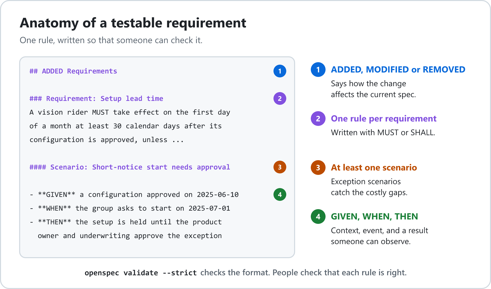

## Step 2: Write requirements and scenarios that catch edge cases

Good framing, @{{ login }}! Your proposal says why and what. Now make it testable: rules that say what MUST happen, and scenarios that show each rule with concrete, synthetic examples, especially for the inputs nobody planned for. This time you write your own prompts.

### 📖 Theory: Requirements, scenarios and strict validation

A **spec delta** lives at `openspec/changes/your-change/specs/your-capability/spec.md` and lists new rules under `## ADDED Requirements`. Each `### Requirement:` states one observable behavior with MUST or SHALL, [RFC 2119](https://www.rfc-editor.org/rfc/rfc2119) keywords written in capitals, and needs at least one `#### Scenario:` with **GIVEN**, **WHEN** and **THEN** steps. The happy path is the easy part: [good specs](https://github.com/Fission-AI/OpenSpec/blob/main/docs/writing-specs.md) also cover empty, conflicting and unexpected inputs, because that is where delivery goes wrong. Strict validation checks the structure, not whether a rule is right; that judgment stays with your team.

### ⌨️ Activity 1: Draft the rules and scenarios

1. Before you look anything up, answer from memory: which three steps does every scenario need, and which two words does strict validation accept in a requirement? Then check yourself.

   <details>
   <summary>Show the answer</summary>

   **GIVEN**, **WHEN** and **THEN**. **MUST** or **SHALL**, in capitals. If you want to see them in place, open `openspec/specs/member-eligibility/spec.md`, or look at the example from exercise 2:

   

   </details>

1. Write your own prompt asking Copilot to challenge your proposal with edge cases. Option A must cover zero, one and multiple matches; option B must cover normal intake and all four exceptions.

   > 💡 **Tip:** Name your proposal and intent brief, tell Copilot not to write code, and ask it to keep unanswered outcomes as open decisions instead of choosing for you.

   <details>
   <summary>Stuck? Show the product-owner prompts</summary><br/>

   - **Option A:** Challenge our candidate matching rule with collisions across source systems, missing fields and zero, one or multiple candidates. Ask what staff may see and do for each result and who resolves ambiguity. After our answers, draft at least three concrete Given/When/Then scenarios, including edge cases. Keep unanswered outcomes marked as open decisions.

   - **Option B:** Challenge our draft with unreadable, incomplete, misrouted and duplicate documents, not just normal intake. Ask what is observed, who acts next, what happens to attachment, pages and receipt clocks, and what happens if a receiving queue is unavailable. After our answers, draft concrete Given/When/Then scenarios covering the happy path and all four exceptions.

   </details>

1. Decide each outcome yourself. Where you can't decide, add it to an `## Open questions` section in your proposal.

1. In your change folder, create `specs/record-identification/spec.md` (option A) or `specs/inbound-document-intake/spec.md` (option B). Write at least three scenarios, including edge cases, in this shape:

   ```markdown
   ## ADDED Requirements

   ### Requirement: Short name of one behavior
   The system MUST (one observable behavior).

   #### Scenario: Short name of one situation
   - **GIVEN** (a concrete starting fact, with synthetic IDs from your intent brief)
   - **WHEN** (one action or event)
   - **THEN** (an observable result someone could check)
   ```

   > 💡 **Tip:** One requirement can have several scenarios. A scenario that only repeats its requirement in other words tests nothing: give it concrete values and one result.

<details>
<summary>Having trouble? 🤷</summary><br/>

- **Copilot keeps writing code or editing files:** Start your prompt with "Do not write code or edit files." Then ask for questions, not answers.

- **You only have happy-path scenarios:** Reread the synthetic examples in your intent brief. Each unusual row is a scenario waiting to be written.

- **Your scenarios sound like the requirement:** Replace general words with the synthetic values from your intent brief, such as a request ID, a record number or a fax number.

</details>

### ⌨️ Activity 2: Validate and push

1. Predict whether strict validation will pass on the first try. Then run it.

   > 
   >
   > ```bash
   > npm run validate:spec
   > ```

1. Fix every error until the output reports no failures. Each message names the file and the requirement it found a problem in.

1. Save, commit with your own message, and push to `first-spec` as you did in step 1.

1. Wait a moment for Mona to check your work, provide feedback, and share the next lesson.

<details>
<summary>Having trouble? 🤷</summary><br/>

- **`should contain SHALL or MUST`:** Write the keyword in capitals in the requirement text, on the lines between the `### Requirement:` heading and its first scenario.

- **`must have at least one scenario`:** Scenario headings need exactly four `#` characters: `#### Scenario:`.

- **`Change must have at least one delta`:** Check the path, `specs/your-capability/spec.md` inside your change folder, and the heading `## ADDED Requirements`.

- **Mona counts fewer scenarios than you wrote:** Mona counts `#### Scenario:` headings in your spec delta. A `### Scenario:` heading is ignored.

- **Mona did not respond:** Check that you pushed to `first-spec`. You can watch the run in the [Actions tab](https://github.com/{{ full_repo_name }}/actions).

</details>
