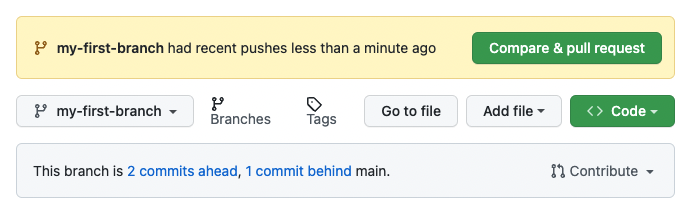

## Step 3: Decide whether your spec is ready to build

Your spec validates, @{{ login }}! :tada: But valid is not the same as ready. Before anyone builds it, your team needs to know which capabilities are real, who the change depends on, which data proves each scenario, and how you'll know it helped. A clear "not ready" is a fine answer here.

### 📖 Theory: The Ready to build gate and honest measures

**Ready to build** is a human gate: the scope is bounded, named people have answered the material questions, assumed capabilities are confirmed with evidence, and every scenario has synthetic test data with a source and an owner. An unconfirmed capability blocks the gate, and an AI answer is not confirmation, so **not ready** with named blockers, owners and next actions is a respectable, useful result. To show later whether the change helped, record one or two delivery measures now: what is counted, the baseline period, the source, the owner and when the baseline will be available. Never invent a baseline: write `unknown — owner to provide` and treat it as a collection task, not as zero.


### ⌨️ Activity 1: Complete the readiness record

1. Copy the readiness template into your change folder as `readiness.md`. Use the line for your option, or your own folder name.

   > 
   >
   > ```bash
   > cp worksheets/readiness-template.md openspec/changes/add-record-identification/readiness.md
   > cp worksheets/readiness-template.md openspec/changes/add-inbound-document-intake/readiness.md
   > ```

1. Fill in **Capability confirmation**, **Dependencies**, **Edge cases** (at least three) and **Synthetic data per scenario**. Write your own prompts; ask Copilot for questions and candidates, not for decisions.

   <details>
   <summary>Stuck? Show the product-owner prompts</summary><br/>

   - **Option A:** Help complete our readiness record's capability, dependency and test data sections. Ask who can confirm the field, index, lookup or API and how; list upstream and downstream owners and behavior if they are not ready. Propose synthetic records and expected results for every scenario, with a data source and owner. Never request production records.

   - **Option B:** Help complete our readiness record's capability, dependency and test data sections. Ask who confirmed OCR, fields, searchable records, APIs and queues, and how. Name upstream and downstream owners and not-ready behavior. Map every scenario to a synthetic document, expected result and data source and owner. Do not request real documents or treat mock flags as proof.

   </details>

1. Check every capability marked as confirmed. If no named role confirmed it with evidence, change it to `unconfirmed`. For this fictional exercise, label any confirmation you role-play as `simulated`.

<details>
<summary>Having trouble? 🤷</summary><br/>

- **`cp` says the folder does not exist:** Your change folder has another name. Run `ls openspec/changes` and use that name in the command.

- **Copilot says a capability exists:** Copilot can't know that. Record it as `unconfirmed` and name the role that could confirm it, such as "Engineering lead, Records Platform".

- **You can't think of three edge cases:** Look at the unusual rows in your intent brief: no match, unreadable, duplicate, missing identifiers. Each one is an edge case.

</details>

### ⌨️ Activity 2: Make the gate decision

1. Pressure-test your record. In a workshop, swap with a neighboring pair and review each other's. On your own, write a prompt asking Copilot to find vague results, unconfirmed capabilities and missing test data, and to leave the decision to you.

   <details>
   <summary>Stuck? Show the product-owner prompt</summary><br/>

   - **Both options:** Review our proposal, spec delta and readiness record against the Ready to build gate described in worksheets/readiness-template.md. Find vague results, unconfirmed capabilities and missing test data. Report conflicts instead of changing our rules. Recommend ready or not ready with reasons, leaving approval to us. Help choose one or two measures and record how, when and by whom their baselines will be collected. Do not implement.

   </details>

1. In the **Decision** section, write your decision after the label, such as `**Decision:** not ready`. Then fill in the reasons, who decided (roles), and what is missing with its owner and next action.

1. Fill at least one row of the **Measures** table. If you don't know a value, write `unknown — owner to provide` instead of a number.

1. Run `npm run validate:spec` once more, then save, commit with your own message, and push to `first-spec`.

<details>
<summary>Having trouble? 🤷</summary><br/>

- **You feel your spec "should" be ready:** Look for any capability still marked `unconfirmed`. If one is material, the honest decision is `not ready`, with the confirmation as the next action.

- **You're tempted to estimate a baseline:** Don't. A made-up number looks like evidence. Write who will collect the baseline and by when.

- **Copilot picked a measure like lines of code or number of prompts:** Choose another one. Count outcomes such as clarification round-trips per work item or days blocked on a dependency.

</details>

### ⌨️ Activity 3: Open a pull request

1. In your browser, go to your repository, `{{ full_repo_name }}`. Open the **Pull requests** tab and [create a pull request](https://docs.github.com/en/pull-requests/collaborating-with-pull-requests/proposing-changes-to-your-work-with-pull-requests/creating-a-pull-request) with `main` as the base branch and `first-spec` as the compare branch. Give it a title that names your change.

   > 💡 **Tip:** If a **Compare & pull request** banner appears for `first-spec`, you can use it instead.

   

1. Wait a moment for Mona to check your work, provide feedback, and share the next lesson.

<details>
<summary>Having trouble? 🤷</summary><br/>

- **Mona says the decision is missing:** Write the decision on one line, right after the label: `**Decision:** ready` or `**Decision:** not ready`. Write one of the two, not both.

- **Mona says the decision has no reason:** Write at least one reason under **Reasons:**, such as the capability that is still unconfirmed.

- **Mona says a measures row is incomplete:** Every cell of at least one row needs a value. `unknown — owner to provide` counts as a value.

- **Mona reported a failed check:** Fix the file, then commit and push to `first-spec` again. Mona checks the pull request again on every push.

- **Mona did not respond:** Check that the pull request targets `main`. You can watch the run in the [Actions tab](https://github.com/{{ full_repo_name }}/actions).

</details>
