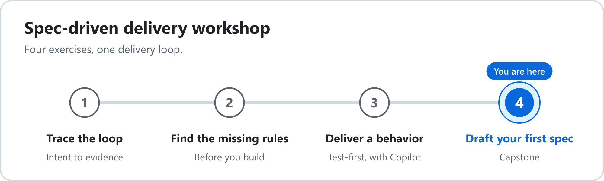

## Review

_Congratulations, you've completed this exercise and the workshop! You turned an unfamiliar problem into a validated OpenSpec change and made an honest Ready to build decision._

Here's a recap of what you accomplished:

- You framed a new change in a proposal with a clear why, what changes and non-goals, keeping unknowns as open questions.
- You wrote requirements with MUST or SHALL and at least three scenarios, including edge cases, that pass strict validation.
- You recorded capability confirmations, dependencies, edge cases, test data and measures, and you made a reasoned ready or not ready decision.

Throughout, Copilot drafted and you decided. Mona checked that your files have the right structure; whether the rules and the decision are right is for your team to judge. Your pull request stays open for your team to read. You can merge it or close it; the exercise is complete either way.

### Check your understanding

Try to answer from memory before you peek. Recalling is what makes it stick.

Your change passes strict validation. Is it ready to build?
 

Not necessarily. Strict validation checks structure: requirements with MUST or SHALL, and scenarios in the right format. Ready to build is a human decision about confirmed capabilities, agreed dependencies, edge cases and test data.

Copilot says a capability your spec needs already exists, such as a lookup by record number or an OCR service. What do you write under Capability confirmation?
 

`unconfirmed`, plus the role that can confirm it and how, such as "Engineering lead, Records Platform: confirm in the lookup's interface documentation". Until that role confirms it with evidence, the capability blocks the gate.

Your team has no baseline for clarification round-trips. What goes in the measures table?
 

What is counted, the baseline period, the source, and `unknown — owner to provide` with an owner and a date. Not zero, and not an estimate: a missing baseline is a collection task.

### Take it to your work

With your team, pick one real backlog item that is about to be planned. In your own team's repository, write its proposal and at least three scenarios, including edge cases, and record a Ready to build decision with named owners. Keep real data where your organization's policies allow it, and never paste it into this exercise repository.

### What's next?

- Run the whole loop on that backlog item with your team: propose, question, decide, deliver against evidence, and keep the living spec current.
- Read [Writing good specs](https://github.com/Fission-AI/OpenSpec/blob/main/docs/writing-specs.md) and [Team workflow](https://github.com/Fission-AI/OpenSpec/blob/main/docs/team-workflow.md) in the OpenSpec documentation.
- Improve how you ask Copilot for drafts with [Prompt engineering for GitHub Copilot Chat](https://docs.github.com/en/copilot/concepts/prompting/prompt-engineering).
- Explore more [GitHub Skills exercises](https://learn.github.com/skills).

